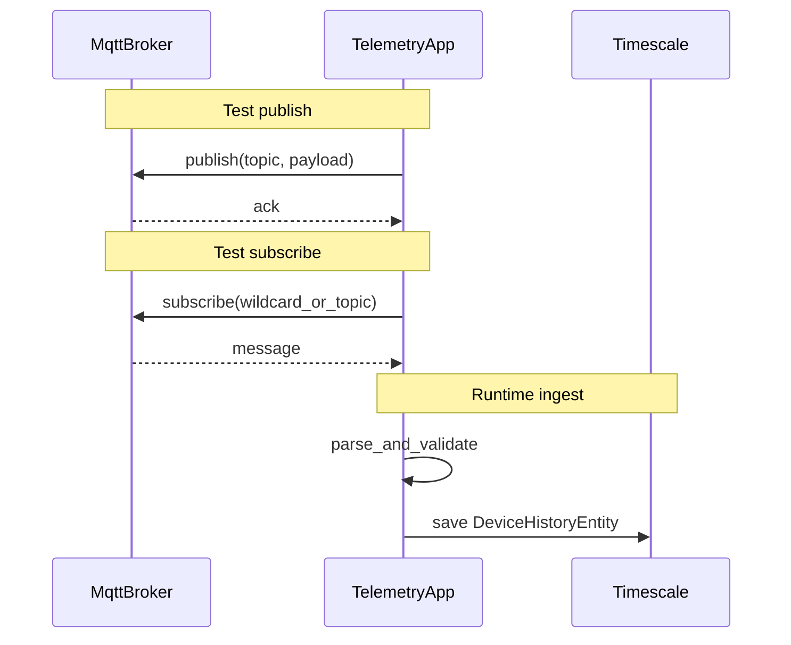

# Plan : MQTT telemetry, tests broker, service `device_histories`

## Liste des fichiers

### À ajouter

|   |   |
|---|---|
|Fichier|Rôle|
|[packages/telemetry/src/services/telemetry-mqtt.client.ts](packages/telemetry/src/services/telemetry-mqtt.client.ts)|Connexion `mqtt://` (mêmes variables que le backend pour le plain : `MQTT_BASE_URL`, `MQTT_PORT_PLAIN`, `MQTT_CLIENT_ID` dédié telemetry, optionnel `MQTT_USERNAME` / `MQTT_PASSWORD` / `MQTT_KEEPALIVE` / `MQTT_CLEAN_SESSION`). Export : constante topic ex. `INTERNAL_TELEMETRY_TOPIC_FILTER = "s1c/internal/telemetry/#"`, `createTelemetryMqttClient()` ou `startTelemetryMqttSubscriber(onMessage?)`, `stopTelemetryMqttClient()`, et une fonction `publish` si vous voulez déjà le chemin query/reply plus tard.|
|[packages/telemetry/src/features/device-histories/device-history-ingest.service.ts](packages/telemetry/src/features/device-histories/device-history-ingest.service.ts) (nom exact au choix)|Service « subscribe » métier : reçoit `(topic, payload)` ou objet déjà parsé, valide le JSON (Zod recommandé, cohérent avec Fastify), construit `DeviceHistoryEntity` (`time`, `deviceId`, `key`, `value`, `raw`) et `repository.save()`.|
|[packages/telemetry/tests/integrations/mqtt-publish.test.ts](packages/telemetry/tests/integrations/mqtt-publish.test.ts)|Test **publication** : broker de test + client qui **publish** sur un topic, assertion que le publish se termine sans erreur ; idéalement un **second client abonné** sur le même topic confirme la réception (ça valide bien la chaîne « publication »).|
|[packages/telemetry/tests/integrations/mqtt-subscribe.test.ts](packages/telemetry/tests/integrations/mqtt-subscribe.test.ts)|Test **subscription** : client A **subscribe**, client B **publish**, assertion sur le message reçu par A (topic + payload).|
|[packages/telemetry/tests/unit/device-history-ingest.service.test.ts](packages/telemetry/tests/unit/device-history-ingest.service.test.ts) (ou sous `src/...`)|Tests du service d’ingestion : payload valide → `save` appelé avec les bons champs ; payload invalide → pas de save / erreur gérée.|

**Broker pour les tests MQTT** : sans imposer Docker dans Vitest, ajouter une **devDependency** type **`aedes`** (broker MQTT minimal en Node), démarrer une instance sur un port aléatoire / libre dans `beforeAll`, connecter avec `mqtt` — pas de dépendance à Mosquitto pour la CI locale. Alternative documentée : `test.skipIf(!process.env.MQTT_INTEGRATION)` + Mosquitto sur `localhost:1883` si vous préférez zéro dépendance npm supplémentaire.

### À modifier

|   |   |
|---|---|
|Fichier|Rôle|
|[packages/telemetry/src/server.ts](packages/telemetry/src/server.ts)|Après `listen`, si `MQTT_START === 'true'`, démarrer le client ; passer au handler MQTT une fonction qui délègue au service d’ingestion (ou log seulement dans un premier commit minimal si vous préférez découper). Hook `onClose` pour `end()` propre du client.|
|[packages/telemetry/development.env](packages/telemetry/development.env)|Aligner sur le backend : `MQTT_START=true`, `MQTT_BASE_URL`, `MQTT_PORT_PLAIN=1883`, `MQTT_CLIENT_ID` (ex. `telemetry-dev`, distinct de `MQTT_CLIENT_ID_PLAIN` backend). Retirer ou dupliquer logiquement `MQTT_BROKER_URL` pour éviter deux sources de vérité (recommandation : **une seule** forme, `BASE_URL` + `PORT` comme le backend).|
|[packages/telemetry/package.json](packages/telemetry/package.json)|DevDependency `aedes` (si option broker embarqué).|

### Optionnel / pas obligatoire pour ce périmètre

- [packages/telemetry/test.env](packages/telemetry/test.env) : s’assurer que lancer l’app test ne démarre pas MQTT (`MQTT_START` absent ou `false`) si un jour `server.ts` est utilisé dans des tests globaux.
    
- [packages/telemetry/rollup.config.js](packages/telemetry/rollup.config.js) : inchangé si l’entrée reste `src/server.ts` (le nouveau code est importé transitivement).
    

---

## Schéma des flux

---

## Contrat JSON → `DeviceHistoryEntity`

L’entité impose : `time` (Date), `deviceId` (uuid), `key` (string), `value` (number), `raw` (json) — voir [device-histories.entity.ts](packages/telemetry/src/features/device-histories/device-histories.entity.ts).

À **fixer dans le plan d’implémentation** (schéma Zod) : champs obligatoires du message MQTT (ex. `device_id`, `key`, `value`, optionnel `time` défaut `new Date()`, `raw` = corps complet ou sous-ensemble). Le **topic** peut aussi contribuer à `device_id` ou `key` si le backend encode l’info dans le chemin sous `s1c/internal/telemetry/...`.

---

## Interprétation des deux tests MQTT

- **Test 1 (publication)** : vérifier qu’un client peut **publier** et que le message est bien **vu sur le broker** (réception par un abonné de test dans le même fichier évite les faux positifs « publish sans erreur » seul).
    
- **Test 2 (subscription)** : vérifier qu’un client **abonné** **reçoit** un message publié par un autre client.
    

Si vous aviez en tête « test 1 = subscribe puis envoyer », c’est en pratique le même scénario que le test 2 ; dans ce cas fusionner en un seul test d’intégration « round-trip » + garder un test publish-only minimal si besoin.

---

## Service d’ingestion + test

- Injecter `AppDataSource.getRepository(DeviceHistoryEntity)` (ou une factory) pour rester testable.
    
- **Test unitaire** : `vi.spyOn(repository, 'save')` ou mock du repository ; pas besoin de Timescale pour valider le mapping et la validation Zod.
    
- **Test d’intégration DB** (optionnel, phase suivante) : `AppDataSource` sur `telemetry_test` + migration run, insert réel — plus lourd, à séparer des tests MQTT rapides.
    

---

## Ordre de travail suggéré

1. Module MQTT + variables d’env + branchement `server.ts` (subscribe sur `s1c/internal/telemetry/#`, handler = log ou no-op temporaire).
    
2. Tests MQTT avec broker embarqué (publish + subscribe).
    
3. Service d’ingestion + schéma payload + branchement dans le handler `message`.
    
4. Tests unitaires du service.