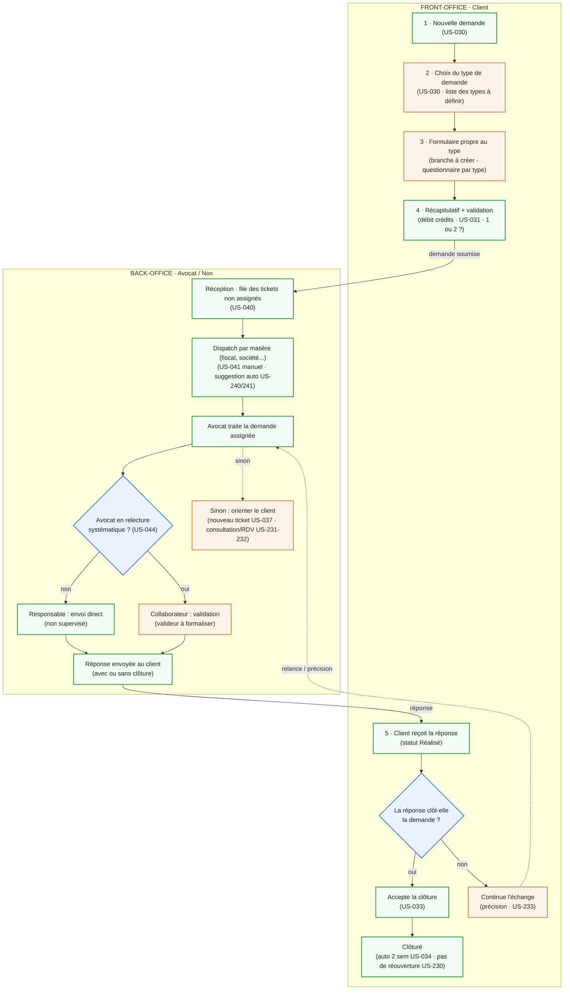

# Nox — Flux métier d'une demande (Front-Office / Back-Office)

> Schéma **à compléter**. Version de travail dérivée des US E04 (Ticketing) et E05 (Dispatch & Workflow interne).
> Légende : **vert** = couvert par une US validée · **orange** = à définir / à compléter · **bleu** = décision.

## Étapes → US → point à compléter

| # | Étape (métier) | Acteur | US | À compléter |
|---|---|---|---|---|
| FO-1 | Nouvelle demande | Client | US-030 | — |
| FO-2 | Choix du type de demande | Client | US-030 | **Liste des types** (Christophe) |
| FO-3 | Formulaire propre au type | Client | US-030 | **Questionnaire conditionnel par type** (branche à créer) |
| FO-4 | Récapitulatif + validation | Client / Système | US-031 | Débit à la création ? 1 ou 2 crédits ? |
| FO-5 | Réception de la réponse | Client | US-032 | — |
| FO-6a | Accepte la clôture | Client | US-033 / US-034 | — |
| FO-6b | Continue l'échange (précision) | Client | US-233 | Gel du SLA pendant l'attente ? |
| BO-1 | Réception file non assignée | Dispatcher | US-040 | — |
| BO-2 | Dispatch par matière | Dispatcher | US-041 / US-240 / US-241 | **Matrice matières x avocats** (Christophe) |
| BO-3 | Traitement par l'avocat | Avocat | — | — |
| BO-3a | Responsable : envoi direct | Avocat | US-044 | — |
| BO-3b | Collaborateur : validation | Avocat | US-044 | **Qui valide** (rôle responsable d'équipe non formalisé) |
| BO-4 | Orienter : nouveau ticket / consultation | Avocat | US-037 / US-231 / US-232 | Matrice + workflow refus client |

## Incohérence à arbitrer
Le schéma linéaire historique débite les crédits **à la clôture**, alors que **US-031 débite à la création** du ticket. À aligner avant de figer le flux.
